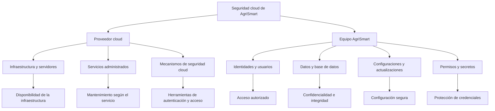
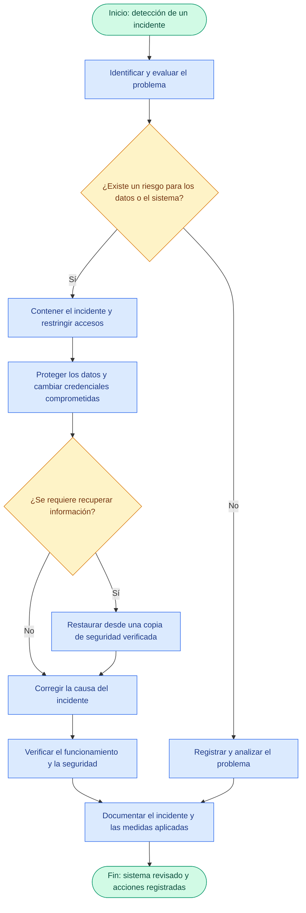

# Proyecto AgriSmart Latacunga — Entregable H2

**Asignatura:** Computación en la Nube / Infraestructura, Seguridad y Gestión de Riesgo en las TI  
**Proyecto:** Evaluación del impacto de una aplicación móvil con inteligencia artificial en la optimización de la calidad del suelo y la productividad agrícola en Latacunga 

# ÍNDICE

1. [Resumen Arquitectónico y Criterio de Clasificación](#1-resumen-arquitectónico-y-criterio-de-clasificación)
2. [Tabla de Clasificación IaaS / PaaS / SaaS del Inventario](#2-tabla-de-clasificación-iaas--paas--saas-del-inventario)
3. [Justificación Técnica de la Distribución de Modelos](#3-justificación-técnica-de-la-distribución-de-modelos)
4. [Comparativa Técnica de Alternativas por Subsistema](#4-comparativa-técnica-de-alternativas-por-subsistema)
   - [4.1. Base de Datos Relacional en la Nube (Consolidación del Estudio)](#41-base-de-datos-relacional-en-la-nube-consolidación-del-estudio)
   - [4.2. Ingesta IoT y Base de Datos de Series de Tiempo](#42-ingesta-iot-y-base-de-datos-de-series-de-tiempo)
   - [4.3. Identidad, Autenticación y Autorización](#43-identidad-autenticación-y-autorización)
   - [4.4. Exposición de APIs y Ejecución de Servicios Backend](#44-exposición-de-apis-y-ejecución-de-servicios-backend)
   - [4.5. Observabilidad y Monitoreo de la Plataforma](#45-observabilidad-y-monitoreo-de-la-plataforma)
5. [Estación 3: Administración y Seguridad Cloud — AgriSmart](#estación-3--administración-y-seguridad-cloud--agrismart)
   - [5.1. Responsabilidad compartida en la nube](#1-responsabilidad-compartida-en-la-nube)
   - [5.2. Matriz general de responsabilidades](#2-matriz-general-de-responsabilidades)
   - [5.3. Diagrama de responsabilidad compartida](#3-diagrama-de-responsabilidad-compartida)
   - [5.4. Administración según el modelo cloud](#4-administración-según-el-modelo-cloud)
   - [5.5. Administración de identidades y permisos](#5-administración-de-identidades-y-permisos)
   - [5.6. Administración y protección de la base de datos](#6-administración-y-protección-de-la-base-de-datos)
   - [5.7. Configuraciones y actualizaciones](#7-configuraciones-y-actualizaciones)
   - [5.8. Administración de secretos](#8-administración-de-secretos)
   - [5.9. Resumen de controles de seguridad](#9-resumen-de-controles-de-seguridad)
   - [5.10. Acuerdo de responsabilidades de AgriSmart](#10-acuerdo-de-responsabilidades-de-agrismart)
6. [Conclusiones para la Integración del H2](#5-conclusiones-para-la-integración-del-h2)

## 1. Resumen Arquitectónico y Criterio de Clasificación

La plataforma **AgriSmart Latacunga** implementa una arquitectura híbrida orientada a eventos **Edge–Fog–Cloud** con servicios hexagonales:

1. **Nivel Edge (Parcela):** Compuesto por 40 nodos fijos ESP32 + LoRa y 4 kits portátiles que capturan datos edafológicos (pH, humedad, temperatura y NPK) cada 15 minutos. Incorpora estrategias de almacenamiento local (store-and-forward) y capacidades de inferencia ligera mediante TinyML para la detección de anomalías directamente en el terreno agrícola.
2. **Nivel Fog (On-Premise en UTC / Parroquia 11 de Noviembre):** Soportado sobre los servidores HP existentes, ejecuta servicios contenerizados interconectados para operar de forma totalmente autónoma sin conexión a internet, garantizando un 0 % de pérdida de datos gracias a la persistencia local de series de tiempo.
3. **Nivel Cloud (AWS y servicios externos):** Capa responsable de consolidar asíncronamente los datos del estudio cuasiexperimental que abarca a 240 agricultores durante los 12 meses de intervención. Aloja el entrenamiento de modelos de inteligencia artificial (Random Forest y XGBoost), la gestión de identidades y la exposición segura de APIs para la aplicación móvil offline-first en Flutter, el panel web de investigadores y los sistemas de aliados estratégicos como el INIAP y el GAD Latacunga.
---

## 2. Tabla de Clasificación IaaS / PaaS / SaaS del Inventario

A continuación se clasifica cada servicio del inventario del backend y de la infraestructura transversal del proyecto:

| # | Servicio / Componente | Capa | Modelo de Servicio | Proveedor / Tecnología | Función en AgriSmart Latacunga | Justificación Técnica de la Clasificación |
| :-: | :--- | :--- | :---: | :--- | :--- | :--- |
| 1 | **Instancias de Cómputo para Contenedores** | Cloud | **IaaS** | AWS EC2 + Docker | Ejecución de contenedores del *Backend for Frontend* (BFF) móvil, servicio receptor de sincronización y tareas de backend. | AWS provee la máquina virtual, red virtual (VPC) y almacenamiento de bloques; el equipo de AgriSmart administra el sistema operativo Linux, el motor de Docker y los contenedores. |
| 2 | **Almacenamiento de Objetos** | Cloud | **IaaS / PaaS** | Amazon S3 | Repositorio del registro de modelos de IA (*champion/challenger*), datasets edafológicos históricos y respaldos. | Aunque provee infraestructura de almacenamiento base (IaaS), opera técnica y operativamente como un servicio gestionado (PaaS): abstrae discos y sistemas de archivos y se consume vía API REST/SDK con escalabilidad automática. |
| 3 | **Base de Datos Relacional Consolidada** | Cloud | **PaaS (DBaaS)** | Amazon RDS (PostgreSQL) | Almacenamiento consolidado del estudio de impacto (línea base, seguimiento de 12 meses y postest) replicado desde el nodo fog (ADR-005). | AWS gestiona el aprovisionamiento del servidor, parches del sistema operativo, actualizaciones del motor PostgreSQL, alta disponibilidad y copias de seguridad automáticas; el equipo solo administra esquemas, consultas y datos. |
| 4 | **Pasarela de APIs** | Cloud | **PaaS** | Amazon API Gateway | Punto de entrada único para las APIs REST (OpenAPI) consumidas por la app móvil Flutter, el panel web de investigadores y los sistemas de INIAP y GAD (ADR-009, ADR-012). | El proveedor administra toda la infraestructura de enrutamiento, control de tráfico (*throttling*), caché y terminación TLS; el equipo únicamente define las rutas, políticas y contratos OpenAPI. |
| 5 | **Gestión de Identidad y Autenticación** | Cloud | **PaaS (IDaaS)** | Amazon Cognito | Autenticación y autorización con OAuth 2.1 / OIDC y PKCE para agricultores, investigadores y aliados externos (ADR-010). | Servicio gestionado de directorio de usuarios y emisión de tokens JWT. Elimina la necesidad de desplegar y mantener servidores de identidad propios, integrándose de forma nativa con API Gateway. |
| 6 | **Gestión de Secretos y Credenciales** | Cloud | **PaaS (SecaaS)** | AWS Secrets Manager | Resguardo cifrado y rotación de credenciales de base de datos, certificados mTLS y llaves de API (ADR-010). | Abstrae el hardware de seguridad (HSM) y la plataforma de bóveda de secretos; los servicios de AgriSmart consumen los secretos mediante llamadas autenticadas al SDK sin exponer variables en el código. |
| 7 | **Entrenamiento de Modelos de IA** | Cloud | **PaaS / CaaS** | Contenedores en AWS + S3 | Entrenamiento y validación de modelos predictivos (exactitud $\ge 85\,\%$ en clasificación y $R^2 \ge 0.80$ en regresión) antes de su descarga al nodo fog (ADR-008). | Se ejecuta bajo demanda sobre entornos contenerizados conectándose al catálogo de datos en RDS y guardando los artefactos entrenados en S3 para su despliegue controlado. |
| 8 | **Servicio de Notificaciones Móviles** | Cloud Externa | **PaaS (BaaS)** | Firebase Cloud Messaging (FCM) | Envío de notificaciones *push* y alertas agronómicas a los dispositivos Android de los agricultores (ADR-007). | Funciona como un *Backend as a Service* (BaaS): Google administra toda la plataforma de colas y entrega a dispositivos Android, mientras que el backend de AgriSmart solo invoca la API de envío. |
| 9 | **Control de Versiones y CI/CD** | Transversal | **SaaS** | GitHub + GitHub Actions | Alojamiento de código fuente, contratos API-First (OpenAPI / AsyncAPI) y tuberías de integración y despliegue continuo (ADR-012). | Es una aplicación completa consumida a través de la web. El equipo de desarrollo no gestiona servidores Git ni nodos de automatización propios; solo configura los flujos de trabajo (`.yml`). |
| 10 | **Nodo Fog (Gateway LoRaWAN, MQTT, Ingesta, IA Local, TimescaleDB, Observabilidad)** | Fog (Borde) | **On-Premise (CaaS local)** | Servidores HP existentes + Docker Compose | Recepción LoRaWAN (ChirpStack), broker MQTT, persistencia de series de tiempo (TimescaleDB), inferencia local (RF/XGBoost), sincronización fog–nube y monitoreo con OpenTelemetry/Prometheus/Grafana (ADR-001 a ADR-012). | Se ejecuta en infraestructura física propia de la UTC o de la parroquia 11 de Noviembre. Usa virtualización ligera por contenedores (Docker Compose) para garantizar operación autónoma cuando falla el enlace a internet. |

---

## 3. Justificación Técnica de la Distribución de Modelos

### 3. Justificación Técnica de la Distribución de Modelos

La elección combinada de **On-Premise (Fog) + IaaS + PaaS + SaaS** responde a cinco restricciones operativas, financieras y arquitectónicas del proyecto AgriSmart Latacunga:

1. **Restricción presupuestaria estricta (85 USD/mes para nube):**
* El presupuesto total del proyecto es de 25.000 USD, de los cuales únicamente 2.000 USD están asignados a servicios en la nube de AWS durante los 24 meses de ejecución (aproximadamente 85 USD mensuales).

* La adopción de servicios **PaaS** de pago por uso o con amplias capas gratuitas (Amazon API Gateway, Amazon Cognito para los 240 agricultores e investigadores, y almacenamiento en Amazon S3) junto con instancias acotadas de Amazon RDS y AWS EC2 mantiene el gasto mensual dentro del techo presupuestario.

* Asimismo, mantener la ingesta intensiva de los 40 nodos fijos (que reportan variables edafológicas cada 15 minutos) y las herramientas de monitoreo (Prometheus, Grafana y OpenTelemetry) en contenedores sobre los servidores HP existentes evita pagar licencias **SaaS** comerciales o costos por millón de mensajes en la nube.

2. **Equipo de desarrollo reducido y alta rotación estudiantil (Módulos M1–M10):**
* El sistema es construido y operado por un equipo docente junto a 30 estudiantes de Sistemas de Información y Software que cumplen 240 horas de prácticas preprofesionales organizadas en 10 módulos técnicos (M1–M10), lo que genera un riesgo alto de rotación por periodos académicos.

* De acuerdo con el **ADR-002** y el **ADR-012**, se descarta una arquitectura de microservicios complejos y se delegan las tareas críticas de administración de infraestructura al modelo **PaaS** (aprovisionamiento, parches de seguridad, respaldos automatizados en RDS y gestión de identidades en Cognito).

* Esto reduce la carga operativa de bajo nivel y previene caídas por errores de configuración manual, mientras que el uso de **SaaS** con GitHub Actions (**ADR-012**) y contratos API-First (**ADR-009**) estandariza la integración continua entre los distintos grupos de estudiantes.

3. **Tolerancia a la desconexión rural e integridad del dato (Riesgo crítico):**
* La conectividad intermitente en las zonas rurales de Latacunga (parroquia 11 de Noviembre) está catalogada como un riesgo de probabilidad alta e impacto alto en el estudio.

* Una arquitectura **100 % en la nube pública** (IaaS o PaaS puro) fracasaría ante los cortes de internet, impidiendo recibir alertas oportunas y provocando pérdida de lecturas edafológicas.

* Por ello, el **ADR-001**, el **ADR-003**, el **ADR-004** y el **ADR-005** mantienen el servidor de red LoRaWAN (ChirpStack), el broker de eventos MQTT y la base de series de tiempo TimescaleDB en el **Nodo Fog local (On-Premise)** para garantizar un **0 % de pérdida de datos** (apoyado en patrones *store-and-forward*, *Transactional Outbox* y registro inmutable) y al menos un 95 % de lecturas recibidas.

* La nube pública se reserva para la consolidación asíncrona mediante el sincronizador fog–nube (que aplica *retry* con *backoff* y *jitter*, *circuit breaker* y *dead letter queue*), la exposición de la API para clientes externos y el almacenamiento histórico del estudio.

4. **Desacoplamiento del ciclo de vida de Inteligencia Artificial y portabilidad (Edge–Fog–Cloud):**
* El **ADR-008** divide estratégicamente las cargas de trabajo de IA según la capacidad de cómputo de cada capa: detección de anomalías ligeras con TinyML en los nodos ESP32 (Edge), inferencia inmediata con modelos Random Forest y XGBoost en el servidor local para emitir recomendaciones sin internet (Fog), y entrenamiento pesado junto al registro de modelos (*champion/challenger*) en AWS (Cloud).

* El uso combinado de **IaaS/CaaS** con contenedores Docker (**ADR-012**) y almacenamiento en **Amazon S3** permite entrenar y validar los modelos en la nube (buscando una exactitud $\ge 85\%$ en clasificación y $R^2 \ge 0,80$ en regresión frente al laboratorio de suelos de la UTC) y luego descargar el modelo aprobado hacia el nodo fog de forma transparente y reproducible.

5. **Cumplimiento de la LOPDP, ética y seguridad multicapa (ADR-010):**
* La investigación recolecta datos personales, productivos y de ubicación de 240 agricultores (120 del grupo de tratamiento y 120 del grupo de control), lo que exige el cumplimiento estricto de la Ley Orgánica de Protección de Datos Personales (LOPDP) antes del levantamiento de la línea base.

* Apoyarse en servicios **PaaS** especializados en seguridad como **Amazon Cognito** (OAuth 2.1 / OIDC con PKCE) y **AWS Secrets Manager** permite implementar controles robustos de autenticación, rotación de credenciales, cifrado en reposo y cifrado en tránsito (HTTPS y mTLS entre el nodo fog y la nube) sin tener que programar sistemas criptográficos ni gestores de identidad desde cero.

* Esta separación facilita además la minimización y seudonimización exigidas por el protocolo ético, vinculando las lecturas agrícolas en RDS y TimescaleDB únicamente a un código identificador mientras los datos sensibles (nombre, cédula y teléfono) permanecen resguardados por separado bajo acceso exclusivo del investigador principal.

## 4. Comparativa Técnica de Alternativas por Subsistema

Para sustentar por qué se eligió cada modelo en el inventario frente a otras opciones posibles, se presenta la comparativa de alternativas técnicas:

### 4.1. Base de Datos Relacional en la Nube (Consolidación del Estudio)

| Criterio | Alternativa IaaS: PostgreSQL en AWS EC2 | Alternativa PaaS: Amazon RDS para PostgreSQL *(Elegida)* | Alternativa SaaS / BaaS: Firebase Firestore |
| :--- | :--- | :--- | :--- |
| **Administración** | El equipo instala PostgreSQL, configura discos EBS, parches de SO y scripts de *backup*. | AWS automatiza parches, respaldos diarios, *snapshots* y recuperación puntual. | Totalmente gestionado por Google, sin servidores visibles. |
| **Adecuación al estudio** | Alta compatibilidad SQL para análisis estadístico (DID y PSM), pero alto riesgo de pérdida por error humano. | Excelente soporte relacional para cruzar línea base, sensores y postest sin riesgo operativo. | Modelo documental NoSQL que dificulta consultas relacionales complejas y cruces estadísticos. |
| **Alineación ADR** | Contradice el ADR-012 (preferencia por servicios administrados en AWS). | **Cumple ADR-005 y ADR-012.** | Descartado por **ADR-007** (Firebase se limita exclusivamente a notificaciones). |

### 4.2. Ingesta IoT y Base de Datos de Series de Tiempo

| Criterio | Alternativa On-Premise Contenerizada: ChirpStack + MQTT + TimescaleDB en Nodo Fog *(Elegida)* | Alternativa PaaS Cloud: AWS IoT Core + Amazon Timestream | Alternativa SaaS IoT: Ubidots / ThingSpeak Comercial |
| :--- | :--- | :--- | :--- |
| **Operación sin internet** | **Total ($100\,\%$ funcional offline).** Captura, almacena y genera alertas localmente en la parroquia o UTC. | **Nula.** Si cae el enlace de internet rural, el gateway no puede enviar tramas a la nube. | **Nula.** Requiere conectividad continua hacia los servidores del proveedor SaaS. |
| **Costo a 24 meses** | Costo de licencia $0\text{ USD}$ (software abierto sobre servidores HP existentes). | Costo variable por millón de mensajes e ingesta continua de 40 nodos cada 15 minutos. | Licencias mensuales elevadas al superar el límite de dispositivos y variables por nodo. |
| **Alineación ADR** | **Cumple ADR-001, ADR-003, ADR-004 y ADR-005.** | Incumple el requisito de resiliencia ante desconexión rural. | Incumple presupuesto y soberanía de datos del estudio. |

### 4.3. Identidad, Autenticación y Autorización

| Criterio | Alternativa IaaS: Keycloak en Docker sobre EC2 | Alternativa PaaS: Amazon Cognito *(Elegida)* | Alternativa SaaS: Auth0 Plan Comercial |
| :--- | :--- | :--- | :--- |
| **Consumo de recursos** | Alto consumo de memoria RAM en la instancia EC2 (Java/Quarkus) y mantenimiento manual. | Sin consumo de cómputo propio; totalmente gestionado por AWS. | Sin consumo de cómputo propio; gestionado en la nube de Auth0. |
| **Integración y Costo** | Gratuito en licencia, pero encarece el tamaño de la instancia EC2 requerida. | Cubierto por la capa gratuita de AWS para el volumen del proyecto (~240 agricultores + investigadores) e integración nativa con API Gateway. | Límites en planes gratuitos para roles avanzados y costo elevado al escalar a planes de pago. |
| **Alineación ADR** | Mayor carga de administración para los estudiantes. | **Cumple ADR-010 y ADR-012** (OAuth 2.1 / OIDC con PKCE integrado en AWS). | Innecesario existiendo integración nativa en el mismo proveedor cloud (AWS). |

### 4.4. Exposición de APIs y Ejecución de Servicios Backend

| Criterio | Alternativa IaaS Pura: Nginx + Contenedores en EC2 | Alternativa Híbrida PaaS + Contenedores: API Gateway + Servicios en Docker *(Elegida)* | Alternativa PaaS Serverless Pura: AWS Lambda para todo el backend |
| :--- | :--- | :--- | :--- |
| **Portabilidad Fog–Cloud** | Alta, pero obliga a gestionar manualmente certificados TLS, *rate limiting* y seguridad perimetral en Nginx. | **Óptima:** API Gateway resuelve la seguridad perimetral y contratos OpenAPI (PaaS), mientras que los contenedores mantienen el mismo empaquetado Docker entre el fog y la nube. | Baja portabilidad hacia el nodo fog local y posibles arranques en frío (*cold starts*) en procesos de sincronización por lotes. |
| **Alineación ADR** | Mayor riesgo en seguridad perimetral para las APIs de aliados (INIAP/GAD). | **Cumple ADR-002, ADR-009 y ADR-012.** | Dificulta la simetría de ejecución con los servicios contenerizados del nodo fog. |

### 4.5. Observabilidad y Monitoreo de la Plataforma

| Criterio | Alternativa Contenerizada: OpenTelemetry + Prometheus + Grafana *(Elegida)* | Alternativa PaaS: Amazon CloudWatch + AWS Managed Grafana | Alternativa SaaS: Datadog / New Relic |
| :--- | :--- | :--- | :--- |
| **Cobertura Híbrida** | Funciona de manera idéntica dentro del nodo fog (sin internet) y en la nube, recolectando métricas, logs y trazas. | Orientado a recursos dentro de AWS; no permite visualizar métricas localmente en el nodo fog si se corta el internet. | Requiere salida permanente a internet para enviar telemetría a la nube del proveedor SaaS. |
| **Impacto en Presupuesto** | **$0\text{ USD}$ en licencias**, ejecutándose como contenedores dentro de la infraestructura existente. | El cobro por métricas personalizadas, ingesta de logs y usuarios de AWS Managed Grafana compromete los $85\text{ USD/mes}$. | Excede ampliamente el presupuesto asignado para nube. |
| **Alineación ADR** | **Cumple estrictamente el ADR-011.** | Descartado por costo y dependencia de internet. | Descartado por costo de licenciamiento. |

---

## ESTACIÓN 3.- Administración y seguridad cloud — AgriSmart

## 1. Responsabilidad compartida en la nube

La administración y seguridad cloud de AgriSmart se fundamenta en el modelo de responsabilidad compartida. Este modelo establece que el proveedor de servicios cloud y el equipo de desarrollo deben cumplir responsabilidades específicas para mantener la seguridad, disponibilidad e integridad del sistema.

El proveedor administra la infraestructura y los componentes incluidos en el servicio contratado. Por su parte, el equipo de AgriSmart administra la aplicación, los datos, las identidades, los permisos y las configuraciones que están bajo su control.

La distribución de responsabilidades depende del modelo cloud utilizado: IaaS, PaaS o SaaS.

## 2. Matriz general de responsabilidades

| Área | Responsabilidad del proveedor cloud | Responsabilidad del equipo AgriSmart |
|---|---|---|
| **Identidades** | Mantener los servicios de autenticación y gestión de identidades que proporciona la plataforma. | Crear y administrar las cuentas de los integrantes, proteger sus credenciales y controlar los accesos al proyecto. |
| **Base de datos** | Mantener la infraestructura y los componentes administrados incluidos en el servicio contratado. | Administrar la estructura lógica, los datos, los usuarios, las consultas y los permisos. Configurar o verificar respaldos según el servicio. |
| **Configuraciones** | Administrar las configuraciones internas de la infraestructura y las opciones propias del servicio. | Configurar la aplicación, las variables de entorno, los parámetros de conexión y las opciones de seguridad disponibles. |
| **Actualizaciones** | Actualizar los sistemas y componentes que administra, según el modelo y el servicio contratado. | Actualizar el código, las dependencias y los componentes bajo su control. En IaaS, también mantener los sistemas operativos instalados por el equipo. |
| **Permisos** | Proporcionar los mecanismos de autorización, roles y políticas de acceso de la plataforma. | Asignar, revisar y revocar permisos de acuerdo con las funciones de cada integrante. |
| **Secretos** | Proporcionar mecanismos de gestión segura de secretos cuando estén disponibles en el servicio. | Proteger contraseñas, tokens, claves API y credenciales de conexión, limitando su acceso y evitando publicarlas en GitHub. |

La matriz representa una distribución general. Las responsabilidades exactas deben confirmarse según el proveedor y los servicios que utilice AgriSmart.

## 3. Diagrama de responsabilidad compartida

El siguiente diagrama muestra cómo se distribuyen las responsabilidades entre el proveedor cloud y el equipo de AgriSmart.

**Interpretación:** el proveedor mantiene los componentes que forman parte de su servicio, mientras que AgriSmart debe utilizar correctamente las herramientas disponibles y administrar de forma segura sus propios recursos. Ambas partes contribuyen a la protección del sistema.

## 4. Administración según el modelo cloud

Los modelos IaaS, PaaS y SaaS distribuyen las responsabilidades de manera diferente. La siguiente tabla compara las tareas relacionadas con las seis áreas solicitadas.

| Área | IaaS | PaaS | SaaS |
|---|---|---|---|
| Identidades | AgriSmart administra las cuentas y los accesos a sus recursos. | AgriSmart administra las cuentas y los accesos disponibles. | AgriSmart gestiona las cuentas de usuario y los roles que permite el servicio. |
| Base de datos | AgriSmart administra el motor si lo instala en sus máquinas virtuales. | El proveedor mantiene el motor si es administrado; AgriSmart gestiona los datos y los accesos. | El proveedor administra la infraestructura de la aplicación; AgriSmart controla sus datos y las opciones disponibles. |
| Configuraciones | AgriSmart administra el sistema operativo, la aplicación y sus recursos. | AgriSmart configura la aplicación y los parámetros disponibles en la plataforma. | AgriSmart configura las opciones que permite la aplicación contratada. |
| Actualizaciones | AgriSmart mantiene los sistemas operativos y componentes que administra. | El proveedor mantiene la plataforma administrada; AgriSmart actualiza su aplicación. | El proveedor actualiza la aplicación SaaS; AgriSmart mantiene sus integraciones propias. |
| Permisos | AgriSmart configura los permisos de sus sistemas y recursos. | AgriSmart asigna los permisos disponibles para la aplicación y los recursos. | AgriSmart administra los roles y accesos que ofrece el servicio. |
| Secretos | AgriSmart protege las credenciales de sus sistemas y aplicaciones. | AgriSmart protege las credenciales de la aplicación y utiliza los mecanismos seguros disponibles. | AgriSmart protege sus cuentas y las credenciales de sus integraciones. |

**Consideración técnica:** IaaS ofrece mayor control directo sobre la infraestructura, pero exige más tareas de mantenimiento al equipo. PaaS reduce la administración de los componentes subyacentes. SaaS delega al proveedor la administración de la aplicación completa, aunque el equipo sigue siendo responsable de utilizarla de forma segura.

## 5. Administración de identidades y permisos

Las identidades permiten reconocer a los usuarios y servicios que acceden a AgriSmart. Los permisos determinan qué acciones pueden realizar sobre los recursos del sistema.

El proveedor cloud proporciona mecanismos para autenticar usuarios y administrar accesos a la plataforma. El equipo de AgriSmart debe configurar estos mecanismos y determinar qué integrantes necesitan acceso a cada recurso.

Para garantizar una administración segura, se aplicará el principio de mínimo privilegio: cada usuario tendrá únicamente los permisos necesarios para realizar sus tareas.

| Control | Aplicación en AgriSmart | Finalidad |
|---|---|---|
| Cuentas individuales | Cada integrante utilizará su propia cuenta. | Identificar quién accede al sistema. |
| Autenticación multifactor | Activarla cuando el servicio la permita. | Reducir el riesgo de acceso por robo de contraseñas. |
| Mínimo privilegio | Asignar solo los permisos necesarios. | Evitar modificaciones o accesos innecesarios. |
| Revisión de accesos | Comprobar periódicamente las cuentas y los roles. | Detectar permisos excesivos o desactualizados. |
| Revocación de permisos | Retirar los accesos que ya no sean necesarios. | Evitar accesos posteriores a la finalización de una responsabilidad. |

## 6. Administración y protección de la base de datos

La base de datos almacena la información que AgriSmart necesita para funcionar. Su administración debe proteger la confidencialidad, la integridad y la disponibilidad de los datos.

El proveedor será responsable de mantener la infraestructura y los componentes incluidos en el servicio contratado. El equipo deberá administrar la estructura lógica, los datos, los usuarios, las consultas y las restricciones de acceso.

| Actividad | Responsable principal | Medida de seguridad |
|---|---|---|
| Mantenimiento de servidores físicos | Proveedor | Mantener la infraestructura operativa y protegida. |
| Mantenimiento del motor de base de datos | Depende del modelo contratado | Aplicar actualizaciones y parches según la distribución de responsabilidades. |
| Administración de usuarios | AgriSmart | Crear cuentas y limitar sus permisos. |
| Protección de conexiones | Compartida según el servicio | Restringir conexiones y utilizar cifrado cuando corresponda. |
| Copias de seguridad | Depende del servicio | Configurar o verificar respaldos y comprobar su recuperación. |
| Protección de información | AgriSmart y proveedor según sus funciones | Evitar accesos no autorizados, modificaciones indebidas y pérdida de datos. |

Las copias de seguridad deben comprobarse periódicamente. No basta con que el servicio indique que existe un respaldo: es necesario verificar que los datos puedan recuperarse cuando ocurra un incidente.

## 7. Configuraciones y actualizaciones

Las configuraciones determinan cómo se ejecuta la aplicación, qué servicios utiliza y quién puede acceder a ellos. Una configuración incorrecta puede exponer recursos o interrumpir el funcionamiento de AgriSmart.

El proveedor administra las configuraciones internas de su infraestructura. El equipo administra las variables de entorno, los parámetros de conexión, las opciones de seguridad y las configuraciones de la aplicación bajo su control.

| Elemento | Responsabilidad de AgriSmart | Control recomendado |
|---|---|---|
| Variables de entorno | Definir los parámetros necesarios para ejecutar la aplicación. | Evitar incluir credenciales directamente en el código. |
| Conexiones | Configurar las conexiones a la base de datos y otros servicios. | Limitar accesos y utilizar conexiones seguras. |
| Entornos de trabajo | Separar desarrollo, pruebas y producción cuando sea posible. | Evitar que las pruebas afecten a los datos reales. |
| Código y dependencias | Mantener las versiones utilizadas por la aplicación. | Revisar vulnerabilidades y compatibilidad. |
| Sistema operativo | Administrarlo directamente en IaaS; en otros modelos depende del servicio. | Aplicar parches cuando sea responsabilidad del equipo. |
| Configuración cloud | Utilizar correctamente las opciones de seguridad disponibles. | Revisar permisos, reglas de acceso y exposición pública. |

Las actualizaciones deben aplicarse de acuerdo con las responsabilidades de cada modelo cloud. El proveedor mantendrá los componentes que administra, mientras que AgriSmart actualizará el código y los componentes propios. Antes de introducir cambios importantes, el equipo deberá evaluar su impacto y comprobar que la aplicación siga funcionando correctamente.

## 8. Administración de secretos

Los secretos son credenciales que permiten acceder a servicios y recursos protegidos. En AgriSmart incluyen contraseñas, tokens, claves API, claves privadas y credenciales de conexión a la base de datos.

El proveedor puede ofrecer un gestor de secretos u otros mecanismos de almacenamiento seguro. El equipo de AgriSmart será responsable de decidir quién puede acceder a las credenciales y de utilizarlas correctamente.

| Aspecto | Responsabilidad de AgriSmart | Control de seguridad |
|---|---|---|
| Responsable | Designar un administrador principal y un suplente. | Mantener clara la responsabilidad sobre las credenciales. |
| Almacenamiento | Utilizar un mecanismo seguro disponible. | Evitar guardar secretos en el repositorio. |
| Acceso | Autorizar únicamente a quienes los necesiten. | Aplicar el mínimo privilegio. |
| Desarrollo | Proteger las credenciales locales. | Utilizar variables de entorno o archivos excluidos mediante `.gitignore`. |
| Renovación | Cambiar las credenciales cuando corresponda. | Reducir el riesgo asociado a secretos expuestos o antiguos. |
| Incidentes | Revocar o cambiar credenciales comprometidas. | Investigar el origen y evaluar los posibles daños. |

El equipo acuerda que ningún secreto real deberá incluirse en archivos de documentación, código fuente, capturas de pantalla o repositorios públicos. Si una credencial se publica accidentalmente, deberá revocarse o cambiarse inmediatamente. Eliminar el archivo no será suficiente si el secreto permanece en el historial de Git.

El administrador principal coordinará la gestión de secretos, mientras que el suplente podrá asumir esta función cuando sea necesario. Ambos serán designados formalmente por el equipo.

## 9. Resumen de controles de seguridad

El siguiente esquema relaciona cada área de administración con su principal objetivo de seguridad.

| Área | Riesgo principal | Control prioritario | Resultado esperado |
|---|---|---|---|
| Identidades | Acceso por usuarios no autorizados. | Cuentas individuales y autenticación segura. | Acceso controlado. |
| Base de datos | Exposición o pérdida de información. | Permisos limitados y copias de seguridad verificadas. | Datos protegidos y recuperables. |
| Configuraciones | Exposición de servicios o errores operativos. | Revisión de parámetros y reglas de acceso. | Entorno correctamente configurado. |
| Actualizaciones | Explotación de vulnerabilidades. | Mantenimiento y aplicación de parches. | Reducción de vulnerabilidades conocidas. |
| Permisos | Privilegios excesivos. | Mínimo privilegio y revisión periódica. | Menor superficie de riesgo. |
| Secretos | Filtración de credenciales. | Almacenamiento seguro y acceso restringido. | Credenciales protegidas. |

## 10. Acuerdo de responsabilidades de AgriSmart

El equipo de AgriSmart establece que la seguridad cloud será gestionada mediante el principio de responsabilidad compartida. El proveedor administrará la infraestructura y los servicios incluidos en su oferta, mientras que el equipo será responsable de proteger la aplicación, los datos, las identidades, las configuraciones, los permisos y los secretos bajo su control.

Las responsabilidades deberán documentarse y revisarse cuando cambie el modelo cloud, el proveedor o la arquitectura del sistema.

## 12. Gestión de incidentes y continuidad operativa

La gestión de incidentes permite establecer los pasos que debe seguir el equipo de AgriSmart cuando se presenta un problema de seguridad o una interrupción del servicio. Su objetivo es reducir los daños, proteger la información y recuperar el funcionamiento del sistema de forma segura.

## Flujo de respuesta ante incidentes

El siguiente diagrama representa el procedimiento que deberá seguir el equipo ante un incidente de seguridad.

Interpretación: ante un incidente, el equipo deberá identificar el problema, contener los riesgos, proteger las credenciales cuando corresponda y recuperar la información si es necesario. Antes de dar por resuelto el incidente, deberá comprobar que el sistema funciona correctamente y documentar las acciones realizadas.

## 13. Conclusiones para la Integración del H2

1. **Predominio estratégico de PaaS en la nube pública:** En la capa Cloud (AWS), el modelo **PaaS** (Amazon RDS, API Gateway, Cognito, Secrets Manager, S3) es la opción técnica más adecuada para AgriSmart Latacunga porque maximiza la disponibilidad y la seguridad reduciendo al mínimo la carga administrativa del equipo docente y estudiantil, manteniéndose dentro del presupuesto de $85\text{ USD/mes}$.
2. **Contenerización sobre IaaS y On-Premise para portabilidad:** El uso de contenedores Docker (sobre servidores HP en el nivel Fog y sobre instancias de cómputo en AWS) permite mantener una arquitectura basada en servicios y eventos (**ADR-002**) altamente portable sin caer en la complejidad operativa de un clúster de microservicios ni en el bloqueo de proveedor (*vendor lock-in*) en la lógica de negocio e inferencia de IA.
3. **Adopción selectiva de SaaS/BaaS:** El uso de **GitHub Actions (SaaS)** para CI/CD y **Firebase Cloud Messaging (BaaS/PaaS)** exclusivamente para notificaciones *push* resuelve necesidades transversales críticas sin costo financiero ni esfuerzo de mantenimiento de infraestructura adicional.
4. **Continuidad y seguridad de la información durante la investigación:** La implementación de un sistema de almacenamiento distribuido entre el Nodo Fog **(TimescaleDB)** y la infraestructura en la nube **(Amazon RDS)** permite mantener la disponibilidad y protección de los datos recopilados en las 240 parcelas agrícolas. Esta arquitectura facilita el registro, almacenamiento y sincronización periódica de las variables edafológicas, incluso ante interrupciones de conectividad en las zonas rurales. De esta manera, se minimiza el riesgo de pérdida de información, se garantiza la trazabilidad de los registros durante los 12 meses de intervención y se dispone de una base de datos confiable para realizar análisis comparativos y evaluar los resultados del estudio de impacto mediante métodos estadísticos.
