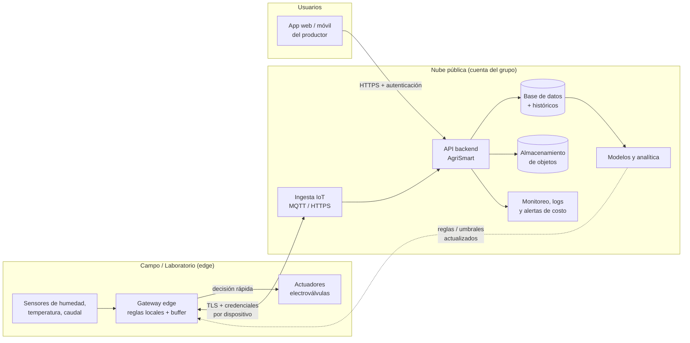

# H3 · Modelo de implementación (AgriSmart Latacunga)

**Proyecto:** Evaluación del impacto de una aplicación móvil con IA en la calidad del suelo y la productividad agrícola en Latacunga  
**Asignatura:** Infraestructura, Seguridad y Gestión de Riesgo en las TI  
**Equipo:** Equipo 4  
**Fecha:** 27 de octubre de 2026  

---

## Índice

- [1. Estación 1 · Requisitos del piloto](#1-estación-1--requisitos-del-piloto-15-min)
- [2. Estación 2 · Elección pública/híbrida](#2-estación-2--elección-públicahíbrida-20-min)
- [3. Estación 3 · Qué queda fuera de la nube pública (15 min)](#3-estación-3--qué-queda-fuera-de-la-nube-pública-15-min)
- [4. Estación 4 · Actualizar mapa del proyecto (10 min)](#4-estación-4--actualizar-mapa-del-proyecto-10-min)
- [5. Resumen Ejecutivo](#5-resumen-ejecutivo)

---

## 1. Estación 1 · Requisitos del piloto

### 1.1 Requisitos priorizados

| Requisito | Descripción | Peso (1-5) | Justificación |
|---|---|---|---|
| **Latencia** | Sincronización fog→nube y respuesta de API para alertas críticas | 5 | Las alertas de riego/fertilidad deben llegar oportunamente. El fog debe seguir operativo sin internet. |
| **Disponibilidad de datos** | Históricos consolidados accesibles desde app móvil/panel web | 5 | Los usuarios necesitan consultar lecturas históricas y reportes. Los datos deben persistir en la nube. |
| **Presupuesto** | Ajustado al límite del piloto (~$83.33 USD/mes) | 4 | Se busca minimizar costos usando ALB + Fargate + RDS sin NAT Gateway ni API Gateway. Presupuesto actual: ~$78.21 USD/mes. |
| **Habilidades del grupo** | Aprovechar conocimientos en contenedores, Docker, PostgreSQL, AWS | 4 | El equipo ya domina Docker Compose (fog), PostgreSQL y despliegue con contenedores. Esto facilita ECS Fargate. |
| **Seguridad** | Tráfico cifrado, red privada para BD, mínimos privilegios | 4 | Crítico para datos agrícolas/sensores. Se usa TLS, mTLS en sincronización, SGs y Secrets Manager. |
| **Escalabilidad** | Autoscaling limitado para el piloto | 3 | Piloto con pocas estaciones; autoscaling 1-2 tareas es suficiente. |
| **Observabilidad** | Logs/métricas básicos | 3 | Necesario para monitoreo con CloudWatch en el alcance del piloto. |

> **Priorización:** Latencia + Disponibilidad de datos > Presupuesto + Habilidades del grupo + Seguridad > Escalabilidad + Observabilidad

**Evidencia para el README:** Requisitos priorizados (tabla 1.1).

---

## 2. Estación 2 · Elección pública/híbrida
**Asignatura:** Infraestructura, Seguridad y Gestión de Riesgo en las TI  
**Equipo:** Equipo 2  
**Fecha:** 27 de octubre de 2026 
### 2.1  Modelo elegido: nube híbrida (edge/laboratorio + nube pública)**
Para el piloto de AgriSmart Latacunga el grupo adopta un modelo híbrido: el borde (campo o laboratorio) toma las decisiones rápidas y la nube pública aloja la API, los históricos y los modelos del SI.

### 2.2 Justificación

AgriSmart captura datos de sensores agrícolas (humedad del suelo, temperatura, riego) en una zona rural de la sierra ecuatoriana, donde la conectividad puede ser intermitente. Una decisión como activar o detener una electroválvula no puede depender de que el enlace a internet esté disponible ni tolerar la latencia de ida y vuelta a un centro de datos remoto. Por eso esa lógica de control rápido se queda en el borde (gateway o microcontrolador con reglas locales y buffer de datos), que sigue operando aunque se corte la conexión.
En cambio, el almacenamiento histórico, la API para la aplicación, la analítica y el entrenamiento de modelos (predicción de riego, alertas) requieren elasticidad, durabilidad y servicios gestionados que serían caros y difíciles de operar en infraestructura propia con el presupuesto y las habilidades de un grupo de estudiantes. La nube pública ofrece pago por uso, escalamiento automático, servicios administrados (base de datos, almacenamiento de objetos, monitoreo) y un ecosistema amplio, con lo que el equipo se concentra en el diseño del SI y no en operar servidores.
Se descarta una nube privada pura por costo y carga operativa (hardware, energía, respaldo, personal) desproporcionados para una prueba. Se descarta una nube pública pura porque dejaría el control del riego sujeto a la conectividad y a la latencia del enlace rural. El híbrido equilibra ambos extremos: resiliencia y baja latencia en campo, escalabilidad y bajo costo inicial en la nube. A cambio, se asume una mayor complejidad de integración (sincronización, autenticación de dispositivos, manejo de datos offline).


### 2.3 Diagrama de arquitectura Lab + Cloud

arquitectura híbrida · borde + nube pública
El control de riego ocurre en el borde; la nube recibe la telemetría y devuelve umbrales actualizados. El monitoreo, los logs y las alertas de gasto cubren toda la cuenta cloud.
Flujos principales:
Ascendente: el gateway envía telemetría a la nube cuando hay enlace; si no, la guarda en buffer y la sincroniza después.
Descendente: la nube pública, umbrales y modelos actualizados al borde.
Control local: el gateway activa las válvulas sin esperar a la nube.
Consulta: el productor accede a datos e históricos mediante la API.


---

## 3. Estación 3 · Qué queda fuera de la nube pública (15 min)
 
**Asignatura:** Infraestructura, Seguridad y Gestión de Riesgo en las TI  
**Equipo:** Equipo 3  
**Fecha:** 27 de octubre de 2026 

### 1. Objetivo
Identificar los componentes que deben permanecer en el laboratorio local (lab) o en el borde de la red (edge), evitando su despliegue en la nube pública por razones de seguridad, latencia, privacidad y disponibilidad.

### 2. Lista de exclusiones

| Componente | Ubicación propuesta | Justificación |
|---|---|---|
| **Credenciales, claves privadas y secretos** | Lab / almacenamiento seguro local | Evitar la exposición de credenciales y accesos no autorizados. |
| **Datos sensibles de usuarios** | Lab / entorno controlado | Reducir el riesgo de filtraciones y accesos indebidos. |
| **Estaciones de sensado (ESP32 + sensores)** | Edge / red local | Necesitan conectividad directa con los equipos y una respuesta rápida. |
| **Gateway LoRaWAN** | Edge / Lab | Punto de recepción de RF, debe estar cerca de sensores. No puede migrarse. |
| **ChirpStack** | Fog/Lab | Gestión de red LoRaWAN, joins, downlinks. Requiere conectividad con gateway local. |
| **Broker MQTT** | Fog/Lab | Mensajería interna de baja latencia entre componentes del fog. |
| **TimescaleDB (fog)** | Fog/Lab | Almacenamiento local de series temporales para operación sin internet. Permite alertas en tiempo real. |
| **Lógica de alertas local** | Edge / Lab | Crítica para respuesta inmediata ante umbrales. Debe funcionar offline. |
| **Servicio de sincronización** | Fog/Lab | Controla qué datos enviar, idempotencia, reintentos y funciona con conectividad intermitente. |
| **Sistemas dependientes de hardware específico** | Lab | Pueden requerir dispositivos, controladores o configuraciones que no están disponibles en la nube. |
| **Copias de seguridad y registros confidenciales** | Almacenamiento protegido local | Evitar que información sensible quede expuesta o sin controles adecuados. |

### 3. Riesgos de desplegar estos componentes en la nube pública

| Riesgo | Explicación | Impacto |
|---|---|---|
| **Seguridad** | Una configuración incorrecta o credenciales expuestas pueden facilitar accesos no autorizados. | **Alto** |
| **Privacidad** | Los datos sensibles pueden quedar expuestos si no existen controles de acceso y protección adecuados. | **Alto** |
| **Latencia** | La comunicación con servidores remotos puede retrasar las operaciones que requieren respuestas inmediatas (ChirpStack/MQTT, alertas). | **Alto** - Pérdida de recepción de datos / retraso en alertas |
| **Disponibilidad** | Una interrupción de Internet puede impedir el acceso a servicios que dependan completamente de la nube. | **Alto** - Operación crítica comprometida |
| **Costos** | Transferir grandes volúmenes de datos o mantener recursos activos puede incrementar los gastos (egress/ingest). | **Medio-Alto** |
| **Compatibilidad** | Algunos componentes pueden depender de hardware o servicios disponibles únicamente en el entorno local (Gateway LoRaWAN). | **Crítico** - No aplicable |

### 4. Límites del despliegue

El despliegue en la nube pública no es la opción por defecto: cada componente se ubica según sus requisitos de seguridad, latencia, privacidad, dependencia de hardware y costo.

#### 4.1 Criterios de decisión

| Criterio | Pregunta de evaluación | Si la respuesta es "sí" |
|---|---|---|
| **Secretos** | ¿Maneja credenciales, claves privadas o tokens? | Lab (almacenamiento seguro local) |
| **Datos sensibles** | ¿Procesa o almacena datos personales o confidenciales? | Lab / entorno controlado |
| **Hardware** | ¿Necesita acceso directo a sensores, dispositivos o controladores? | Edge / lab |
| **Latencia** | ¿Requiere respuesta en tiempo real o muy baja latencia? | Edge |
| **Conectividad** | ¿Debe operar aunque se caiga Internet? | Edge / lab |
| **Respaldos y registros** | ¿Genera copias o logs confidenciales? | Almacenamiento protegido local |
| **Costo** | ¿Mueve grandes volúmenes de datos o requiere recursos siempre activos? | Evaluar local o híbrido |

#### 4.2 Ubicación por tipo de componente

| Tipo de componente | Lab | Edge | Nube pública |
|---|---|---|---|
| **Credenciales, claves y secretos** | ✔ | ✘ | ✘ |
| **Datos sensibles de usuarios** | ✔ | ✘ | Solo cifrados y anonimizados |
| **Sensores y dispositivos físicos** | ✘ | ✔ | ✘ |
| **Servicios de baja latencia** | ✔ | ✔ | ✘ |
| **Sistemas dependientes de hardware** | ✔ | ✔ | ✘ |
| **Copias de seguridad y registros confidenciales** | ✔ | ✘ | Solo cifrados |
| **Paneles de visualización y documentación** | ✔ | ✘ | ✔ |
| **Análisis posterior con datos anonimizados** | ✔ | ✘ | ✔ |
| **Repositorio de código (sin secretos)** | ✔ | ✘ | ✔ |

#### 4.3 Condiciones para evaluar la nube pública

Un componente solo puede desplegarse en la nube si cumple todas estas condiciones:

| Condición | Detalle |
|---|---|
| **Independencia del hardware** | No depende de dispositivos ni de la red local. |
| **Sin información crítica** | No maneja secretos ni datos sensibles, o estos van cifrados y con acceso restringido. |
| **Tolerancia a la latencia** | Funciona correctamente con la comunicación remota. |
| **Tolerancia a desconexión** | Una caída de Internet no afecta la operación crítica. |
| **Costo aceptable** | El gasto de ejecución y transferencia de datos es razonable. |

#### 4.4 Despliegue híbrido

Cuando un componente cumple solo parcialmente los criterios, se divide en dos partes:

| Parte | Ubicación | Ejemplos |
|---|---|---|
| **Crítica** | Lab / edge | Captura de datos, control de dispositivos, manejo de secretos. |
| **No crítica** | Nube pública | Visualización, documentación, análisis con datos anonimizados. |

#### 4.5 Proceso de decisión

| Paso | Acción | Resultado |
|---|---|---|
| **1** | Evaluar el componente con la tabla 4.1. | Si cumple algún criterio, permanece en lab o edge. |
| **2** | Si no cumple ninguno, evaluarlo con 4.3. | Si cumple todas las condiciones, es candidato a la nube. |
| **3** | Si el resultado es parcial, aplicar 4.4. | Se divide en parte crítica y no crítica. |
| **4** | Documentar la decisión. | Queda registrada la ubicación y su justificación. |

### 5. Medidas de protección

#### 5.1 Medidas por área

| Área | Medida | Objetivo |
|---|---|---|
| **Control de acceso** | Asignar permisos según las funciones de cada usuario (principio de mínimo privilegio). | Evitar accesos innecesarios o no autorizados. |
| **Secretos** | No subir contraseñas, tokens ni claves privadas al repositorio; usar variables de entorno o un almacén seguro local. | Evitar la exposición de credenciales. |
| **Datos sensibles** | Proteger con cifrado (en reposo y en tránsito) y controles de acceso. | Reducir el riesgo de filtraciones. |
| **Copias de seguridad** | Mantenerlas protegidas, cifradas y verificar periódicamente su recuperación. | Garantizar la recuperación sin exponer información. |
| **Registros (logs)** | Evitar guardar datos sensibles en los registros y restringir quién puede consultarlos. | Evitar filtraciones por logs. |
| **Red** | Limitar los puertos y servicios expuestos; separar la red del lab y del edge de la red pública. | Reducir la superficie de ataque. |
| **Documentación** | Registrar los componentes excluidos de la nube y justificar cada decisión. | Mantener trazabilidad y claridad. |

#### 5.2 Buenas prácticas para el repositorio

| Práctica | Detalle |
|---|---|
| **Archivo .gitignore** | Incluir archivos de configuración local, claves, certificados y archivos .env. |
| **Archivo de ejemplo** | Usar un archivo .env.example con nombres de variables sin valores reales. |
| **Revisión antes de subir** | Verificar que ningún commit contenga credenciales o datos sensibles. |
| **Rotación de credenciales** | Si una credencial se expone, cambiarla de inmediato, aunque se haya borrado del repositorio. |

#### 5.3 Verificación periódica

| Verificación | Frecuencia sugerida | Responsable |
|---|---|---|
| **Revisar permisos de usuarios** | Mensual | Administrador del lab |
| **Probar la recuperación de copias de seguridad** | Trimestral | Administrador del lab |
| **Revisar que no haya secretos en el repositorio** | En cada cambio importante | Equipo de desarrollo |
| **Actualizar la lista de componentes excluidos** | Cuando cambie la arquitectura | Equipo del proyecto |

### Conclusión

No todos los componentes de un sistema deben desplegarse en la nube pública. Mantener determinados recursos en el laboratorio o en el edge permite responder a requisitos de latencia, seguridad, privacidad y dependencia del hardware. La arquitectura debe definir explícitamente qué servicios se despliegan en cada entorno y por qué.

**Evidencia para el README:** Límites del despliegue.

## Estación 4 · Actualizar mapa del proyecto 

**Equipo:** Equipo 4

### Acción a realizar

1. Actualizar documentación del repositorio con el modelo híbrido elegido
2. Crear/actualizar `docs/nube-H3.md` con el contenido de las 4 estaciones
3. Actualizar referencias en `README.md` y `docs/nube-H2.md` si aplica
4. Realizar commit con mensaje claro

### Comandos (Git)

```bash
git add docs/nube-H3.md docs/arquitectura/README.md docs/nube-H2.md 2>/dev/null
git commit -m "H3 modelo implementacion"
```

### Evidencia para el README: Commit H3 visible en el historial

**Estado:** Archivo `docs/nube-H3.md` creado con todas las estaciones completadas.

## Resumen Ejecutivo

- **Modelo:** Híbrido Lab + Cloud
- **Cloud:** AWS con ECS Fargate, RDS PostgreSQL, ALB (sin NAT/API Gateway en piloto)
- **Fog/Lab:** ChirpStack, MQTT, TimescaleDB, alertas locales - operación sin internet
- **Flujo:** fog nunca escribe directo a RDS, sincronización vía API con HTTPS/mTLS
- **Costo:** Dentro de presupuesto (~$78.21 USD/mes)
- **Prioridad:** Resiliencia + latencia local sobre migración completa a nube
