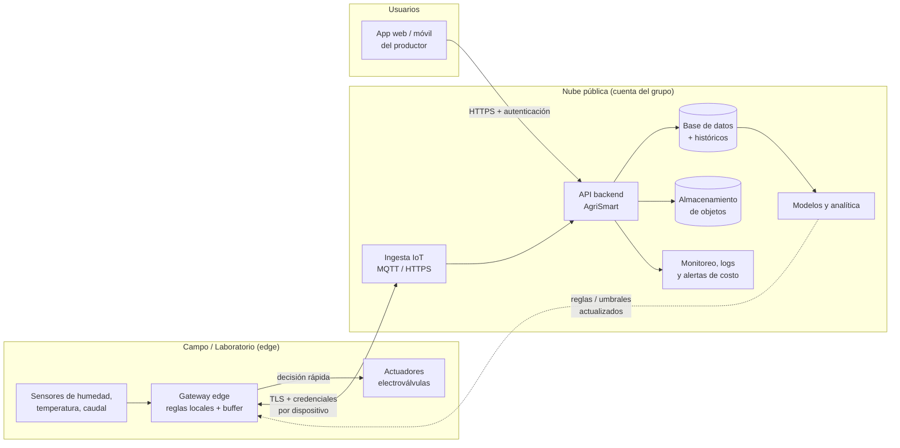

# H3 · Modelo de implementación (AgriSmart Latacunga)

**Proyecto:** Evaluación del impacto de una aplicación móvil con IA en la calidad del suelo y la productividad agrícola en Latacunga  
**Asignatura:** Infraestructura, Seguridad y Gestión de Riesgo en las TI  
**Equipo:** Equipo 4  
**Fecha:** 27 de octubre de 2026  

---

## Índice

- [1. Estación 1 · Requisitos del piloto (15 min)](#1-estación-1--requisitos-del-piloto-15-min)
- [2. Estación 2 · Elección pública/híbrida (20 min)](#2-estación-2--elección-públicahíbrida-20-min)
- [3. Estación 3 · Qué queda fuera de la nube pública (15 min)](#3-estación-3--qué-queda-fuera-de-la-nube-pública-15-min)
- [4. Estación 4 · Actualizar mapa del proyecto (10 min)](#4-estación-4--actualizar-mapa-del-proyecto-10-min)
- [5. Resumen Ejecutivo](#5-resumen-ejecutivo)

---

## 1. Estación 1 · Requisitos del piloto

### 1.1 Requisitos priorizados
### Introducción .
AgriSmart Latacunga propone una solución de agricultura de precisión que integra dispositivos ESP32 y LoRaWAN, un nodo local fog, servicios de nube y una aplicación móvil Flutter con funcionamiento sin conexión. Para que el backend sea viable, primero se requiere identificar cada servicio, su función, dónde se ejecutará y de qué otros componentes depende. Este documento desarrolla el inventario a cargo del Grupo 1 en el hito H2. No constituye evidencia de despliegues ya realizados.
### Objetivo y alcance
 Objetivo: identificar, describir y priorizar los servicios de infraestructura, plataforma e integración necesarios para el backend de AgriSmart Latacunga, de modo que los demás equipos puedan clasificarlos, analizar su seguridad y justificar las decisiones arquitectónicas.
- Incluye API, cómputo, persistencia transaccional, archivos, identidad, integración IoT, mensajería, monitoreo, automatización, copias de seguridad y comunicaciones.
- Distingue servicios en AWS, software propio y componentes locales fog/edge.
- Registra estados verificables; no incluye aprovisionamiento, compras ni uso de credenciales de cuentas personales.
###  Referencia de la arquitectura
Flujo previsto: sensores ESP32/LoRaWAN → gateway y ChirpStack en fog → broker MQTT e ingesta → base de series temporales fog → sincronización segura → servicios cloud/API → aplicación Flutter y panel de investigación. La app conserva datos localmente mediante SQLite. Si Internet falla, la captura y el almacenamiento local deben continuar; la sincronización se reanuda al restablecerse la red.
Este flujo es una propuesta extraída de la versión 3 del proyecto y debe validarse con el equipo general. El backend cloud no recibe directamente cada lectura LoRaWAN: la arquitectura distingue claramente el gateway y el fog del procesamiento en AWS.
##  Inventario técnico de servicios


| ID | Componente | Tecnología candidata | Función | Ubicación | Estado |
| --- | --- | --- | --- | --- | --- |
| S01 | Cómputo backend | AWS EC2 o servicio administrado por decidir | Ejecutar API y tareas de aplicación | Cloud | Propuesto |
| S02 | API de aplicación | Servicio REST propio; OpenAPI | Exponer datos y operaciones de agricultores/parcelas | Cloud | Por desarrollar |
| S03 | Base de datos operacional | PostgreSQL en Amazon RDS | Persistir usuarios seudonimizados, parcelas y registros | Cloud | Propuesto |
| S04 | Objetos y respaldos | Amazon S3 | Guardar datasets, exportaciones, archivos y modelos | Cloud | Propuesto |
| S05 | Identidad y acceso | Amazon Cognito u OIDC equivalente | Autenticar usuarios y roles con control de acceso | Cloud | Propuesto |
| S06 | Red y protección | VPC, subredes, SG, TLS y DNS | Aislar componentes y proteger comunicaciones | Cloud | Por diseñar |
| S07 | Observabilidad cloud | CloudWatch; métricas y logs | Registrar errores, disponibilidad y alertas operativas | Cloud | Propuesto |
| S08 | CI/CD | GitHub Actions + repositorio | Automatizar pruebas y despliegues versionados | SaaS externo | Por confirmar |
| S09 | Notificaciones móviles | Firebase Cloud Messaging | Avisos y alertas cuando el teléfono tenga conectividad | Servicio externo | Propuesto |
| S10 | Correo opcional | Amazon SES u otro | Enviar mensajes de soporte o verificación si aplica | Cloud | Opcional |
| S11 | Gateway LoRaWAN | Gateway + ChirpStack | Concentrar tramas y gestionar dispositivos | Fog/local | Recurso por verificar |
| S12 | Mensajería fog | Broker MQTT | Distribuir eventos a consumidores locales | Fog/local | Propuesto |
| S13 | Series temporales fog | PostgreSQL/TimescaleDB | Guardar lecturas aun sin Internet | Fog/local | Propuesto |
| S14 | Sincronización | Servicio propio store-and-forward | Replicar lecturas de forma idempotente a nube | Fog↔cloud | Por desarrollar |
| S15 | Inferencia local | Servicio de modelos IA en fog | Producir recomendaciones disponibles sin Internet | Fog/local | Por validar |
| S16 | Datos móviles | SQLite en Flutter | Permitir consulta y cola de acciones offline | Dispositivo | Por desarrollar |

Nota: "Propuesto" significa identificado en el planteamiento; "Por desarrollar" no implica que exista; "Por confirmar" requiere evidencia institucional. Los nombres comerciales no equivalen a un inventario contratado.


##  Criterios de selección de recursos

Para recomendar tecnologías se consideraron seis criterios: compatibilidad con la arquitectura edge–fog–cloud; tolerancia a conectividad intermitente; seguridad y protección de datos; facilidad de mantenimiento por estudiantes; posibilidad de ampliar un piloto; y costo total de operación. El inventario prioriza la función necesaria antes que la marca del proveedor. No se presupone que una herramienta sea conveniente solo por pertenecer a AWS.


| Criterio | Pregunta de evaluación | Implicación para el inventario |
| --- | --- | --- |
| Compatibilidad | ¿Se integra con Flutter, MQTT, PostgreSQL y APIs REST? | Preferir formatos y protocolos abiertos. |
| Conectividad | ¿La pérdida de Internet afecta la captura? | Mantener persistencia en fog y reenvío posterior. |
| Seguridad | ¿Puede limitarse el acceso por roles y red? | Diseñar IAM, subred privada, TLS y secretos. |
| Operación | ¿Puede mantenerlo un equipo de curso? | Minimizar componentes y automatizar pruebas. |
| Costo | ¿Genera cargos fijos o por consumo? | Validar presupuesto y apagar recursos de prueba. |
| Escalabilidad | ¿Permite ampliar volumen sin rediseño total? | Separar API, base de datos y objetos. |


##  Justificación de tecnologías recomendadas

La siguiente tabla explica las recomendaciones del Grupo 1. Son candidatas para la Estación 1 y serán confirmadas o modificadas por los equipos responsables de clasificación y decisión arquitectónica.


| Servicio | Recomendación y motivo | Alternativa y condición de elección |
| --- | --- | --- |
| Cómputo / API | EC2 con Docker: da control de sistema operativo y despliegue; útil para aprender IaaS y ejecutar un backend propio. | AWS App Runner o ECS/Fargate: menor administración del host, sujeto a cotización y compatibilidad. |
| Base transaccional | PostgreSQL en RDS: relaciones entre usuarios, parcelas, cultivos y labores; el servicio administra varias tareas de base de datos. | PostgreSQL en EC2/fog: menor dependencia de servicio gestionado, pero más carga de operación y backup. |
| Archivos y modelos | Amazon S3: almacenamiento de objetos separado del servidor; útil para datasets, archivos y artefactos de modelos. | Sistema de archivos del servidor solo para pruebas temporales; no como repositorio persistente principal. |
| Identidad | Amazon Cognito: autenticación administrada y federación; evita implementar almacenamiento de contraseñas desde cero. | Proveedor OIDC alternativo si la institución ya dispone de identidad centralizada. |
| Red y secretos | VPC/subredes y roles IAM; Secrets Manager según presupuesto: reducen exposición de DB y credenciales. | Variables protegidas gestionadas por la plataforma para piloto, nunca secretos en Git. |
| CI y control de cambios | GitHub y GitHub Actions: revisiones por ramas, pruebas automáticas y trazabilidad de cada hito. | GitLab CI si el curso ya opera allí; no duplicar herramientas. |
| Observabilidad | CloudWatch para métricas y logs cloud; Grafana local si ya existe en fog. | Prometheus/Grafana autogestionado si el equipo asume mantenimiento y almacenamiento. |
| Mensajería IoT | ChirpStack más MQTT en fog: integración LoRaWAN y entrega de eventos desacoplados, conforme a la arquitectura prevista. | AWS IoT Core solo si se decide enviar eventos directamente a la nube y se acepta dependencia de red. |
| Notificaciones | Firebase Cloud Messaging para notificaciones push de Flutter cuando exista conectividad. | Alertas internas de la app para escenarios offline; correo solo cuando el caso de uso lo exija. |
| Correo | Amazon SES es opcional para invitaciones, restablecimiento u otros correos; no es requisito para captura de sensores. | No desplegar correo en el piloto si no hay caso de uso aprobado. |


##  Alcance mínimo viable recomendado

Para un piloto universitario es razonable iniciar con una API REST, PostgreSQL, almacenamiento de objetos, autenticación básica segura, red restringida, repositorio y pruebas automatizadas; integrar gradualmente el nodo fog con MQTT y sincronización. El uso de EC2, RDS y S3 es una propuesta coherente pero no supone presupuesto aprobado. La aplicación no debe depender de conexión permanente para guardar tareas en el dispositivo.

No se recomienda desplegar simultáneamente todos los servicios opcionales. Primero se debe demostrar con un flujo pequeño que una lectura de sensor llega al fog, se conserva durante una desconexión, se sincroniza sin duplicados y aparece en la API.


##  Servicios mínimos y dependencias


| Prioridad | Servicios | Motivo | Condición para avanzar |
| --- | --- | --- | --- |
| P0 crítico | S01, S02, S03, S06 | Sin cómputo, API, datos y red segura no existe backend cloud operable. | Elegir alojamiento y contratos API/datos. |
| P1 necesario | S04, S05, S07, S08, S14 | Identidad, trazabilidad, archivos y sincronización confiable. | Definir permisos, políticas de backup y pruebas. |
| P2 complementario | S09, S10 | Mensajería externa condicionada al diseño de experiencia. | Confirmar casos de uso y costo. |
| Infraestructura local | S11, S12, S13, S15, S16 | Permite funcionamiento rural con desconexiones. | Coordinar con módulos fog, IoT y app. |

Dependencias clave: la API necesita conectividad privada a PostgreSQL, mecanismo de autenticación, secretos y registros; el sincronizador necesita identificación única por lectura, reintentos y reglas de resolución; la notificación push requiere dispositivo registrado y conexión de salida.


##  Mapa del backend por ubicación


| Zona | Servicios que operan | Interfaz principal | Responsabilidad del sistema |
| --- | --- | --- | --- |
| Parcela / edge | ESP32, sensores, radio LoRa, buffer local | Paquetes LoRaWAN | Medición y reenvío; calibración y energía. |
| Fog institucional/local | ChirpStack, MQTT, TimescaleDB, alertas, sincronizador | MQTT/HTTPS seguro | Persistencia durante cortes y envío posterior. |
| AWS / cloud | API, RDS, S3, identidad, monitoreo | HTTPS REST y réplica segura | Consolidación, acceso y administración central. |
| Cliente | Flutter, SQLite | HTTPS + caché local | Uso offline y sincronización eventual. |


##  Validación de recursos existentes

El documento fuente menciona servidores HP existentes y tecnologías planificadas, pero no aporta evidencia de que estén aprovisionadas para la clase. Este registro debe completarse con el responsable del curso antes de afirmar que un servicio existe.


| Recurso | Estado actual verificable | Evidencia que debe adjuntarse | Responsable |
| --- | --- | --- | --- |
| Repositorio GitHub del curso | No confirmado | URL del repositorio y captura de README | Coordinación H1 |
| Cuenta AWS del grupo | No confirmado | Identificador de cuenta parcial y roles, sin secretos | Coordinación cloud |
| Instancia EC2 / servicio API | No confirmado | Inventario de recursos; no mostrar IP privada sensible | Infraestructura |
| RDS PostgreSQL | No confirmado | Captura de estado y tipo de instancia, sin claves | Datos |
| Bucket S3 | No confirmado | Inventario de buckets y política revisada | Datos |
| Gateway LoRaWAN y servidores HP | Mencionados en propuesta; operación no comprobada | Acta/inventario institucional y prueba básica | Equipo IoT/fog |
| CI y monitoreo | No confirmado | Workflow y captura de ejecución o tablero | DevOps |


##  Seguridad y riesgos del inventario


| Riesgo | Control propuesto | Evidencia futura |
| --- | --- | --- |
| Credenciales expuestas en repositorio | Usar roles, gestores de secretos y .gitignore; prohibir access keys en capturas. | Revisión de repositorio y política IAM. |
| Base de datos públicamente accesible | RDS en subred privada, SG restrictivos y cifrado. | Diagrama de red y configuración sin secretos. |
| Pérdida de lecturas ante cortes | Colas locales, reintentos idempotentes, backup y pruebas de reconexión. | Prueba de desconexión/reenvío. |
| Costos inesperados de AWS | Presupuesto, alertas, etiquetas y apagado de recursos no esenciales. | Captura de presupuesto y estimación. |
| Datos personales y geográficos | Acceso por roles, seudonimización, minimización y consentimiento. | Política de datos aprobada. |

Riesgo residual: las medidas propuestas reducen la exposición, pero no sustituyen auditorías de seguridad, verificación de respaldos ni pruebas en campo.


##  Actividades y evidencias


| Paso | Actividad | Producto verificable |
| --- | --- | --- |
| 1 | Revisar arquitectura y listar componentes | Inventario S01–S16 y alcance. |
| 2 | Validar dependencias y ubicación | Mapa por edge/fog/cloud/cliente. |
| 3 | Consultar recursos que realmente existen | Tabla de estados con evidencias o pendientes. |
| 4 | Registrar riesgos y acuerdos | Riesgos, controles y notas para equipos 2–4. |
| 5 | Entregar fragmento aprobado a docs/nube-H2.md | Commit y actualización del README. |
| 6 | Socializar a los otros equipos | Acta o comentario de revisión y cambios. |

Capturas sugeridas: estructura del repositorio, arquitectura del proyecto, inventario cloud obtenido sin secretos y commit que incorpora el apartado. No se deben fabricar capturas ni declarar recursos operativos sin validación.


##  Entrega a los otros equipos


| Equipo receptor | Información entregada | Decisión que deberá completar |
| --- | --- | --- |
| Grupo 2 Modelos cloud | S01–S16, ubicación y tecnología candidata | Clasificar servicios concretos IaaS/PaaS/SaaS y justificar. |
| Grupo 3 Seguridad | Datos almacenados, interfaces, zonas y riesgos | Responsabilidades compartidas, identidad y manejo de secretos. |
| Grupo 4 Arquitectura | Dependencias P0/P1 y alternativas | Decisión versionada de alojamiento de API y base de datos. |

Acuerdo recomendado: el inventario funciona como lista base controlada por versiones. Ningún equipo debe sustituir un componente sin comunicarlo y actualizar las dependencias.


| Requisito | Descripción | Peso (1-5) | Justificación |
|---|---|---|---|
| **Latencia** | Sincronización fog→nube y respuesta de API para alertas críticas | 5 | Las alertas de riego/fertilidad deben llegar oportunamente. El fog debe seguir operativo sin internet. |
| **Disponibilidad de datos** | Históricos consolidados accesibles desde app móvil/panel web | 5 | Los usuarios necesitan consultar lecturas históricas y reportes. Los datos deben persistir en la nube. |
| **Presupuesto** | Ajustado al límite del piloto (~$83.33 USD/mes) | 4 | Se busca minimizar costos usando ALB + Fargate + RDS sin NAT Gateway ni API Gateway. Presupuesto actual: ~$78.21 USD/mes. |
| **Habilidades del grupo** | Aprovechar conocimientos en contenedores, Docker, PostgreSQL, AWS | 4 | El equipo ya domina Docker Compose (fog), PostgreSQL y despliegue con contenedores. Esto facilita ECS Fargate. |
| **Seguridad** | Tráfico cifrado, red privada para BD, mínimos privilegios | 4 | Crítico para datos agrícolas/sensores. Se usa TLS, mTLS en sincronización, SGs y Secrets Manager. |
| **Escalabilidad** | Autoscaling limitado para el piloto | 3 | Piloto con pocas estaciones; autoscaling 1-2 tareas es suficiente. |
| **Observabilidad** | Logs/métricas básicos | 3 | Necesario para monitoreo con CloudWatch en el alcance del piloto. |

> **Priorización:** Latencia + Disponibilidad de datos > Presupuesto + Habilidades del grupo + Seguridad > Escalabilidad + Observabilidad

---

## 2. Estación 2 · Elección pública/híbrida

### 2.1  Modelo elegido: nube híbrida (edge/laboratorio + nube pública)**
Para el piloto de AgriSmart Latacunga el grupo adopta un modelo híbrido: el borde (campo o laboratorio) toma las decisiones rápidas y la nube pública aloja la API, los históricos y los modelos del SI.

### 2.2 Justificación

AgriSmart captura datos de sensores agrícolas (humedad del suelo, temperatura, riego) en una zona rural de la sierra ecuatoriana, donde la conectividad puede ser intermitente. Una decisión como activar o detener una electroválvula no puede depender de que el enlace a internet esté disponible ni tolerar la latencia de ida y vuelta a un centro de datos remoto. Por eso esa lógica de control rápido se queda en el borde (gateway o microcontrolador con reglas locales y buffer de datos), que sigue operando aunque se corte la conexión.
En cambio, el almacenamiento histórico, la API para la aplicación, la analítica y el entrenamiento de modelos (predicción de riego, alertas) requieren elasticidad, durabilidad y servicios gestionados que serían caros y difíciles de operar en infraestructura propia con el presupuesto y las habilidades de un grupo de estudiantes. La nube pública ofrece pago por uso, escalamiento automático, servicios administrados (base de datos, almacenamiento de objetos, monitoreo) y un ecosistema amplio, con lo que el equipo se concentra en el diseño del SI y no en operar servidores.
Se descarta una nube privada pura por costo y carga operativa (hardware, energía, respaldo, personal) desproporcionados para una prueba. Se descarta una nube pública pura porque dejaría el control del riego sujeto a la conectividad y a la latencia del enlace rural. El híbrido equilibra ambos extremos: resiliencia y baja latencia en campo, escalabilidad y bajo costo inicial en la nube. A cambio, se asume una mayor complejidad de integración (sincronización, autenticación de dispositivos, manejo de datos offline).


### 2.3 Diagrama de arquitectura Lab + Cloud

arquitectura híbrida · borde + nube pública
El control de riego ocurre en el borde; la nube recibe la telemetría y devuelve umbrales actualizados. El monitoreo, los logs y las alertas de gasto cubren toda la cuenta cloud.
Flujos principales:
Ascendente: el gateway envía telemetría a la nube cuando hay enlace; si no, la guarda en buffer y la sincroniza después.
Descendente: la nube pública, umbrales y modelos actualizados al borde.
Control local: el gateway activa las válvulas sin esperar a la nube.
Consulta: el productor accede a datos e históricos mediante la API.


---

## 3. Estación 3 · ¿Qué queda fuera de la nube pública ?
 
**Asignatura:** Infraestructura, Seguridad y Gestión de Riesgo en las TI  
**Equipo:** Equipo 3  
**Fecha:** 27 de octubre de 2026 

### 1. Objetivo
Identificar los componentes que deben permanecer en el laboratorio local (lab) o en el borde de la red (edge), evitando su despliegue en la nube pública por razones de seguridad, latencia, privacidad y disponibilidad.

### 2. Lista de exclusiones

| Componente | Ubicación propuesta | Justificación |
|---|---|---|
| **Credenciales, claves privadas y secretos** | Lab / almacenamiento seguro local | Evitar la exposición de credenciales y accesos no autorizados. |
| **Datos sensibles de usuarios** | Lab / entorno controlado | Reducir el riesgo de filtraciones y accesos indebidos. |
| **Estaciones de sensado (ESP32 + sensores)** | Edge / red local | Necesitan conectividad directa con los equipos y una respuesta rápida. |
| **Gateway LoRaWAN** | Edge / Lab | Punto de recepción de RF, debe estar cerca de sensores. No puede migrarse. |
| **ChirpStack** | Fog/Lab | Gestión de red LoRaWAN, joins, downlinks. Requiere conectividad con gateway local. |
| **Broker MQTT** | Fog/Lab | Mensajería interna de baja latencia entre componentes del fog. |
| **TimescaleDB (fog)** | Fog/Lab | Almacenamiento local de series temporales para operación sin internet. Permite alertas en tiempo real. |
| **Lógica de alertas local** | Edge / Lab | Crítica para respuesta inmediata ante umbrales. Debe funcionar offline. |
| **Servicio de sincronización** | Fog/Lab | Controla qué datos enviar, idempotencia, reintentos y funciona con conectividad intermitente. |
| **Sistemas dependientes de hardware específico** | Lab | Pueden requerir dispositivos, controladores o configuraciones que no están disponibles en la nube. |
| **Copias de seguridad y registros confidenciales** | Almacenamiento protegido local | Evitar que información sensible quede expuesta o sin controles adecuados. |

### 3. Riesgos de desplegar estos componentes en la nube pública

| Riesgo | Explicación | Impacto |
|---|---|---|
| **Seguridad** | Una configuración incorrecta o credenciales expuestas pueden facilitar accesos no autorizados. | **Alto** |
| **Privacidad** | Los datos sensibles pueden quedar expuestos si no existen controles de acceso y protección adecuados. | **Alto** |
| **Latencia** | La comunicación con servidores remotos puede retrasar las operaciones que requieren respuestas inmediatas (ChirpStack/MQTT, alertas). | **Alto** - Pérdida de recepción de datos / retraso en alertas |
| **Disponibilidad** | Una interrupción de Internet puede impedir el acceso a servicios que dependan completamente de la nube. | **Alto** - Operación crítica comprometida |
| **Costos** | Transferir grandes volúmenes de datos o mantener recursos activos puede incrementar los gastos (egress/ingest). | **Medio-Alto** |
| **Compatibilidad** | Algunos componentes pueden depender de hardware o servicios disponibles únicamente en el entorno local (Gateway LoRaWAN). | **Crítico** - No aplicable |

### 4. Límites del despliegue

El despliegue en la nube pública no es la opción por defecto: cada componente se ubica según sus requisitos de seguridad, latencia, privacidad, dependencia de hardware y costo.

#### 4.1 Criterios de decisión

| Criterio | Pregunta de evaluación | Si la respuesta es "sí" |
|---|---|---|
| **Secretos** | ¿Maneja credenciales, claves privadas o tokens? | Lab (almacenamiento seguro local) |
| **Datos sensibles** | ¿Procesa o almacena datos personales o confidenciales? | Lab / entorno controlado |
| **Hardware** | ¿Necesita acceso directo a sensores, dispositivos o controladores? | Edge / lab |
| **Latencia** | ¿Requiere respuesta en tiempo real o muy baja latencia? | Edge |
| **Conectividad** | ¿Debe operar aunque se caiga Internet? | Edge / lab |
| **Respaldos y registros** | ¿Genera copias o logs confidenciales? | Almacenamiento protegido local |
| **Costo** | ¿Mueve grandes volúmenes de datos o requiere recursos siempre activos? | Evaluar local o híbrido |

#### 4.2 Ubicación por tipo de componente

| Tipo de componente | Lab | Edge | Nube pública |
|---|---|---|---|
| **Credenciales, claves y secretos** | ✔ | ✘ | ✘ |
| **Datos sensibles de usuarios** | ✔ | ✘ | Solo cifrados y anonimizados |
| **Sensores y dispositivos físicos** | ✘ | ✔ | ✘ |
| **Servicios de baja latencia** | ✔ | ✔ | ✘ |
| **Sistemas dependientes de hardware** | ✔ | ✔ | ✘ |
| **Copias de seguridad y registros confidenciales** | ✔ | ✘ | Solo cifrados |
| **Paneles de visualización y documentación** | ✔ | ✘ | ✔ |
| **Análisis posterior con datos anonimizados** | ✔ | ✘ | ✔ |
| **Repositorio de código (sin secretos)** | ✔ | ✘ | ✔ |

#### 4.3 Condiciones para evaluar la nube pública

Un componente solo puede desplegarse en la nube si cumple todas estas condiciones:

| Condición | Detalle |
|---|---|
| **Independencia del hardware** | No depende de dispositivos ni de la red local. |
| **Sin información crítica** | No maneja secretos ni datos sensibles, o estos van cifrados y con acceso restringido. |
| **Tolerancia a la latencia** | Funciona correctamente con la comunicación remota. |
| **Tolerancia a desconexión** | Una caída de Internet no afecta la operación crítica. |
| **Costo aceptable** | El gasto de ejecución y transferencia de datos es razonable. |

#### 4.4 Despliegue híbrido

Cuando un componente cumple solo parcialmente los criterios, se divide en dos partes:

| Parte | Ubicación | Ejemplos |
|---|---|---|
| **Crítica** | Lab / edge | Captura de datos, control de dispositivos, manejo de secretos. |
| **No crítica** | Nube pública | Visualización, documentación, análisis con datos anonimizados. |

#### 4.5 Proceso de decisión

| Paso | Acción | Resultado |
|---|---|---|
| **1** | Evaluar el componente con la tabla 4.1. | Si cumple algún criterio, permanece en lab o edge. |
| **2** | Si no cumple ninguno, evaluarlo con 4.3. | Si cumple todas las condiciones, es candidato a la nube. |
| **3** | Si el resultado es parcial, aplicar 4.4. | Se divide en parte crítica y no crítica. |
| **4** | Documentar la decisión. | Queda registrada la ubicación y su justificación. |

### 5. Medidas de protección

#### 5.1 Medidas por área

| Área | Medida | Objetivo |
|---|---|---|
| **Control de acceso** | Asignar permisos según las funciones de cada usuario (principio de mínimo privilegio). | Evitar accesos innecesarios o no autorizados. |
| **Secretos** | No subir contraseñas, tokens ni claves privadas al repositorio; usar variables de entorno o un almacén seguro local. | Evitar la exposición de credenciales. |
| **Datos sensibles** | Proteger con cifrado (en reposo y en tránsito) y controles de acceso. | Reducir el riesgo de filtraciones. |
| **Copias de seguridad** | Mantenerlas protegidas, cifradas y verificar periódicamente su recuperación. | Garantizar la recuperación sin exponer información. |
| **Registros (logs)** | Evitar guardar datos sensibles en los registros y restringir quién puede consultarlos. | Evitar filtraciones por logs. |
| **Red** | Limitar los puertos y servicios expuestos; separar la red del lab y del edge de la red pública. | Reducir la superficie de ataque. |
| **Documentación** | Registrar los componentes excluidos de la nube y justificar cada decisión. | Mantener trazabilidad y claridad. |

#### 5.2 Buenas prácticas para el repositorio

| Práctica | Detalle |
|---|---|
| **Archivo .gitignore** | Incluir archivos de configuración local, claves, certificados y archivos .env. |
| **Archivo de ejemplo** | Usar un archivo .env.example con nombres de variables sin valores reales. |
| **Revisión antes de subir** | Verificar que ningún commit contenga credenciales o datos sensibles. |
| **Rotación de credenciales** | Si una credencial se expone, cambiarla de inmediato, aunque se haya borrado del repositorio. |

#### 5.3 Verificación periódica

| Verificación | Frecuencia sugerida | Responsable |
|---|---|---|
| **Revisar permisos de usuarios** | Mensual | Administrador del lab |
| **Probar la recuperación de copias de seguridad** | Trimestral | Administrador del lab |
| **Revisar que no haya secretos en el repositorio** | En cada cambio importante | Equipo de desarrollo |
| **Actualizar la lista de componentes excluidos** | Cuando cambie la arquitectura | Equipo del proyecto |

### Conclusión

No todos los componentes de un sistema deben desplegarse en la nube pública. Mantener determinados recursos en el laboratorio o en el edge permite responder a requisitos de latencia, seguridad, privacidad y dependencia del hardware. La arquitectura debe definir explícitamente qué servicios se despliegan en cada entorno y por qué.

**Evidencia para el README:** Límites del despliegue.

## Estación 4 · Actualizar mapa del proyecto 

### Acción a realizar

1. Actualizar documentación del repositorio con el modelo híbrido elegido
2. Crear/actualizar `docs/nube-H3.md` con el contenido de las 4 estaciones
3. Actualizar referencias en `docs/arquitectura/README.md` y `docs/nube-H2.md` si aplica
4. Realizar commit con mensaje claro

### Comandos (Git)

```bash
git add docs/nube-H3.md docs/arquitectura/README.md docs/nube-H2.md 2>/dev/null
git commit -m "H3 modelo implementacion"
```

### Evidencia para el README: Commit H3 visible en el historial

**Estado:** Archivo `docs/nube-H3.md` creado con todas las estaciones completadas.

## Resumen Ejecutivo

- **Modelo:** Híbrido Lab + Cloud
- **Cloud:** AWS con ECS Fargate, RDS PostgreSQL, ALB (sin NAT/API Gateway en piloto)
- **Fog/Lab:** ChirpStack, MQTT, TimescaleDB, alertas locales - operación sin internet
- **Flujo:** fog nunca escribe directo a RDS, sincronización vía API con HTTPS/mTLS
- **Costo:** Dentro de presupuesto (~$78.21 USD/mes)
- **Prioridad:** Resiliencia + latencia local sobre migración completa a nube
