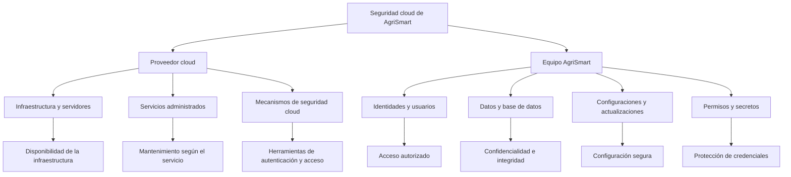

# Administración y seguridad cloud — AgriSmart

## 1. Responsabilidad compartida en la nube

La administración y seguridad cloud de AgriSmart se fundamenta en el modelo de responsabilidad compartida. Este modelo establece que el proveedor de servicios cloud y el equipo de desarrollo deben cumplir responsabilidades específicas para mantener la seguridad, disponibilidad e integridad del sistema.

El proveedor administra la infraestructura y los componentes incluidos en el servicio contratado. Por su parte, el equipo de AgriSmart administra la aplicación, los datos, las identidades, los permisos y las configuraciones que están bajo su control.

La distribución de responsabilidades depende del modelo cloud utilizado: IaaS, PaaS o SaaS.

## 2. Matriz general de responsabilidades

| Área | Responsabilidad del proveedor cloud | Responsabilidad del equipo AgriSmart |
|---|---|---|
| **Identidades** | Mantener los servicios de autenticación y gestión de identidades que proporciona la plataforma. | Crear y administrar las cuentas de los integrantes, proteger sus credenciales y controlar los accesos al proyecto. |
| **Base de datos** | Mantener la infraestructura y los componentes administrados incluidos en el servicio contratado. | Administrar la estructura lógica, los datos, los usuarios, las consultas y los permisos. Configurar o verificar respaldos según el servicio. |
| **Configuraciones** | Administrar las configuraciones internas de la infraestructura y las opciones propias del servicio. | Configurar la aplicación, las variables de entorno, los parámetros de conexión y las opciones de seguridad disponibles. |
| **Actualizaciones** | Actualizar los sistemas y componentes que administra, según el modelo y el servicio contratado. | Actualizar el código, las dependencias y los componentes bajo su control. En IaaS, también mantener los sistemas operativos instalados por el equipo. |
| **Permisos** | Proporcionar los mecanismos de autorización, roles y políticas de acceso de la plataforma. | Asignar, revisar y revocar permisos de acuerdo con las funciones de cada integrante. |
| **Secretos** | Proporcionar mecanismos de gestión segura de secretos cuando estén disponibles en el servicio. | Proteger contraseñas, tokens, claves API y credenciales de conexión, limitando su acceso y evitando publicarlas en GitHub. |

La matriz representa una distribución general. Las responsabilidades exactas deben confirmarse según el proveedor y los servicios que utilice AgriSmart.

## 3. Diagrama de responsabilidad compartida

El siguiente diagrama muestra cómo se distribuyen las responsabilidades entre el proveedor cloud y el equipo de AgriSmart.

**Interpretación:** el proveedor mantiene los componentes que forman parte de su servicio, mientras que AgriSmart debe utilizar correctamente las herramientas disponibles y administrar de forma segura sus propios recursos. Ambas partes contribuyen a la protección del sistema.

## 4. Administración según el modelo cloud

Los modelos IaaS, PaaS y SaaS distribuyen las responsabilidades de manera diferente. La siguiente tabla compara las tareas relacionadas con las seis áreas solicitadas.

| Área | IaaS | PaaS | SaaS |
|---|---|---|---|
| Identidades | AgriSmart administra las cuentas y los accesos a sus recursos. | AgriSmart administra las cuentas y los accesos disponibles. | AgriSmart gestiona las cuentas de usuario y los roles que permite el servicio. |
| Base de datos | AgriSmart administra el motor si lo instala en sus máquinas virtuales. | El proveedor mantiene el motor si es administrado; AgriSmart gestiona los datos y los accesos. | El proveedor administra la infraestructura de la aplicación; AgriSmart controla sus datos y las opciones disponibles. |
| Configuraciones | AgriSmart administra el sistema operativo, la aplicación y sus recursos. | AgriSmart configura la aplicación y los parámetros disponibles en la plataforma. | AgriSmart configura las opciones que permite la aplicación contratada. |
| Actualizaciones | AgriSmart mantiene los sistemas operativos y componentes que administra. | El proveedor mantiene la plataforma administrada; AgriSmart actualiza su aplicación. | El proveedor actualiza la aplicación SaaS; AgriSmart mantiene sus integraciones propias. |
| Permisos | AgriSmart configura los permisos de sus sistemas y recursos. | AgriSmart asigna los permisos disponibles para la aplicación y los recursos. | AgriSmart administra los roles y accesos que ofrece el servicio. |
| Secretos | AgriSmart protege las credenciales de sus sistemas y aplicaciones. | AgriSmart protege las credenciales de la aplicación y utiliza los mecanismos seguros disponibles. | AgriSmart protege sus cuentas y las credenciales de sus integraciones. |

**Consideración técnica:** IaaS ofrece mayor control directo sobre la infraestructura, pero exige más tareas de mantenimiento al equipo. PaaS reduce la administración de los componentes subyacentes. SaaS delega al proveedor la administración de la aplicación completa, aunque el equipo sigue siendo responsable de utilizarla de forma segura.

## 5. Administración de identidades y permisos

Las identidades permiten reconocer a los usuarios y servicios que acceden a AgriSmart. Los permisos determinan qué acciones pueden realizar sobre los recursos del sistema.

El proveedor cloud proporciona mecanismos para autenticar usuarios y administrar accesos a la plataforma. El equipo de AgriSmart debe configurar estos mecanismos y determinar qué integrantes necesitan acceso a cada recurso.

Para garantizar una administración segura, se aplicará el principio de mínimo privilegio: cada usuario tendrá únicamente los permisos necesarios para realizar sus tareas.

| Control | Aplicación en AgriSmart | Finalidad |
|---|---|---|
| Cuentas individuales | Cada integrante utilizará su propia cuenta. | Identificar quién accede al sistema. |
| Autenticación multifactor | Activarla cuando el servicio la permita. | Reducir el riesgo de acceso por robo de contraseñas. |
| Mínimo privilegio | Asignar solo los permisos necesarios. | Evitar modificaciones o accesos innecesarios. |
| Revisión de accesos | Comprobar periódicamente las cuentas y los roles. | Detectar permisos excesivos o desactualizados. |
| Revocación de permisos | Retirar los accesos que ya no sean necesarios. | Evitar accesos posteriores a la finalización de una responsabilidad. |

## 6. Administración y protección de la base de datos

La base de datos almacena la información que AgriSmart necesita para funcionar. Su administración debe proteger la confidencialidad, la integridad y la disponibilidad de los datos.

El proveedor será responsable de mantener la infraestructura y los componentes incluidos en el servicio contratado. El equipo deberá administrar la estructura lógica, los datos, los usuarios, las consultas y las restricciones de acceso.

| Actividad | Responsable principal | Medida de seguridad |
|---|---|---|
| Mantenimiento de servidores físicos | Proveedor | Mantener la infraestructura operativa y protegida. |
| Mantenimiento del motor de base de datos | Depende del modelo contratado | Aplicar actualizaciones y parches según la distribución de responsabilidades. |
| Administración de usuarios | AgriSmart | Crear cuentas y limitar sus permisos. |
| Protección de conexiones | Compartida según el servicio | Restringir conexiones y utilizar cifrado cuando corresponda. |
| Copias de seguridad | Depende del servicio | Configurar o verificar respaldos y comprobar su recuperación. |
| Protección de información | AgriSmart y proveedor según sus funciones | Evitar accesos no autorizados, modificaciones indebidas y pérdida de datos. |

Las copias de seguridad deben comprobarse periódicamente. No basta con que el servicio indique que existe un respaldo: es necesario verificar que los datos puedan recuperarse cuando ocurra un incidente.

## 7. Configuraciones y actualizaciones

Las configuraciones determinan cómo se ejecuta la aplicación, qué servicios utiliza y quién puede acceder a ellos. Una configuración incorrecta puede exponer recursos o interrumpir el funcionamiento de AgriSmart.

El proveedor administra las configuraciones internas de su infraestructura. El equipo administra las variables de entorno, los parámetros de conexión, las opciones de seguridad y las configuraciones de la aplicación bajo su control.

| Elemento | Responsabilidad de AgriSmart | Control recomendado |
|---|---|---|
| Variables de entorno | Definir los parámetros necesarios para ejecutar la aplicación. | Evitar incluir credenciales directamente en el código. |
| Conexiones | Configurar las conexiones a la base de datos y otros servicios. | Limitar accesos y utilizar conexiones seguras. |
| Entornos de trabajo | Separar desarrollo, pruebas y producción cuando sea posible. | Evitar que las pruebas afecten a los datos reales. |
| Código y dependencias | Mantener las versiones utilizadas por la aplicación. | Revisar vulnerabilidades y compatibilidad. |
| Sistema operativo | Administrarlo directamente en IaaS; en otros modelos depende del servicio. | Aplicar parches cuando sea responsabilidad del equipo. |
| Configuración cloud | Utilizar correctamente las opciones de seguridad disponibles. | Revisar permisos, reglas de acceso y exposición pública. |

Las actualizaciones deben aplicarse de acuerdo con las responsabilidades de cada modelo cloud. El proveedor mantendrá los componentes que administra, mientras que AgriSmart actualizará el código y los componentes propios. Antes de introducir cambios importantes, el equipo deberá evaluar su impacto y comprobar que la aplicación siga funcionando correctamente.

## 8. Administración de secretos

Los secretos son credenciales que permiten acceder a servicios y recursos protegidos. En AgriSmart incluyen contraseñas, tokens, claves API, claves privadas y credenciales de conexión a la base de datos.

El proveedor puede ofrecer un gestor de secretos u otros mecanismos de almacenamiento seguro. El equipo de AgriSmart será responsable de decidir quién puede acceder a las credenciales y de utilizarlas correctamente.

| Aspecto | Responsabilidad de AgriSmart | Control de seguridad |
|---|---|---|
| Responsable | Designar un administrador principal y un suplente. | Mantener clara la responsabilidad sobre las credenciales. |
| Almacenamiento | Utilizar un mecanismo seguro disponible. | Evitar guardar secretos en el repositorio. |
| Acceso | Autorizar únicamente a quienes los necesiten. | Aplicar el mínimo privilegio. |
| Desarrollo | Proteger las credenciales locales. | Utilizar variables de entorno o archivos excluidos mediante `.gitignore`. |
| Renovación | Cambiar las credenciales cuando corresponda. | Reducir el riesgo asociado a secretos expuestos o antiguos. |
| Incidentes | Revocar o cambiar credenciales comprometidas. | Investigar el origen y evaluar los posibles daños. |

El equipo acuerda que ningún secreto real deberá incluirse en archivos de documentación, código fuente, capturas de pantalla o repositorios públicos. Si una credencial se publica accidentalmente, deberá revocarse o cambiarse inmediatamente. Eliminar el archivo no será suficiente si el secreto permanece en el historial de Git.

El administrador principal coordinará la gestión de secretos, mientras que el suplente podrá asumir esta función cuando sea necesario. Ambos serán designados formalmente por el equipo.

## 9. Resumen de controles de seguridad

El siguiente esquema relaciona cada área de administración con su principal objetivo de seguridad.

| Área | Riesgo principal | Control prioritario | Resultado esperado |
|---|---|---|---|
| Identidades | Acceso por usuarios no autorizados. | Cuentas individuales y autenticación segura. | Acceso controlado. |
| Base de datos | Exposición o pérdida de información. | Permisos limitados y copias de seguridad verificadas. | Datos protegidos y recuperables. |
| Configuraciones | Exposición de servicios o errores operativos. | Revisión de parámetros y reglas de acceso. | Entorno correctamente configurado. |
| Actualizaciones | Explotación de vulnerabilidades. | Mantenimiento y aplicación de parches. | Reducción de vulnerabilidades conocidas. |
| Permisos | Privilegios excesivos. | Mínimo privilegio y revisión periódica. | Menor superficie de riesgo. |
| Secretos | Filtración de credenciales. | Almacenamiento seguro y acceso restringido. | Credenciales protegidas. |

## 10. Acuerdo de responsabilidades de AgriSmart

El equipo de AgriSmart establece que la seguridad cloud será gestionada mediante el principio de responsabilidad compartida. El proveedor administrará la infraestructura y los servicios incluidos en su oferta, mientras que el equipo será responsable de proteger la aplicación, los datos, las identidades, las configuraciones, los permisos y los secretos bajo su control.

Las responsabilidades deberán documentarse y revisarse cuando cambie el modelo cloud, el proveedor o la arquitectura del sistema.
